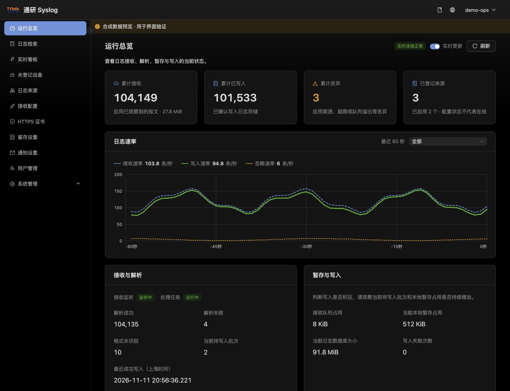
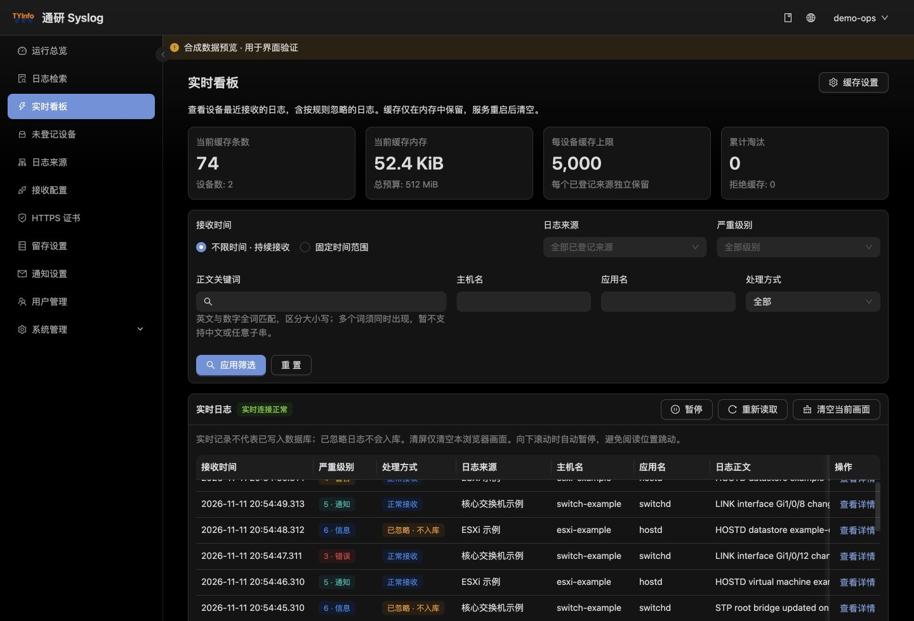
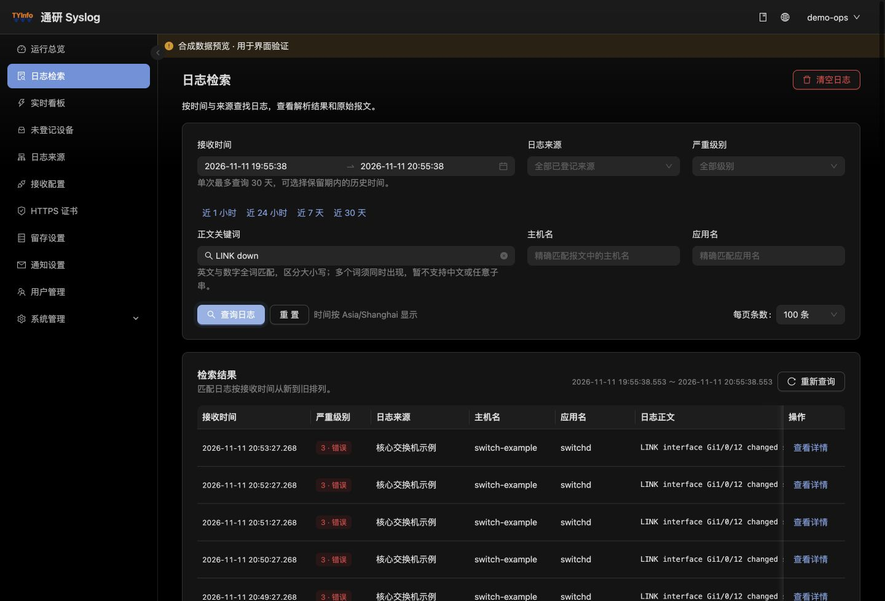
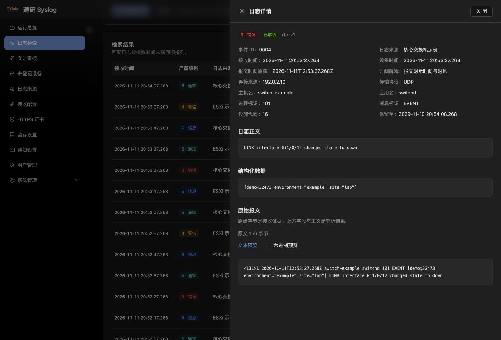
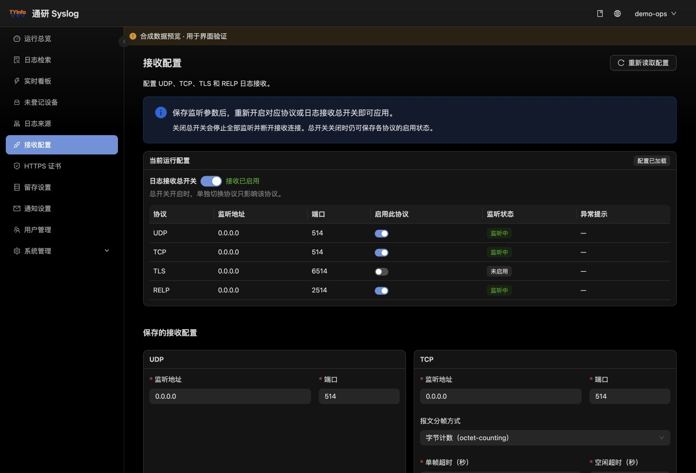
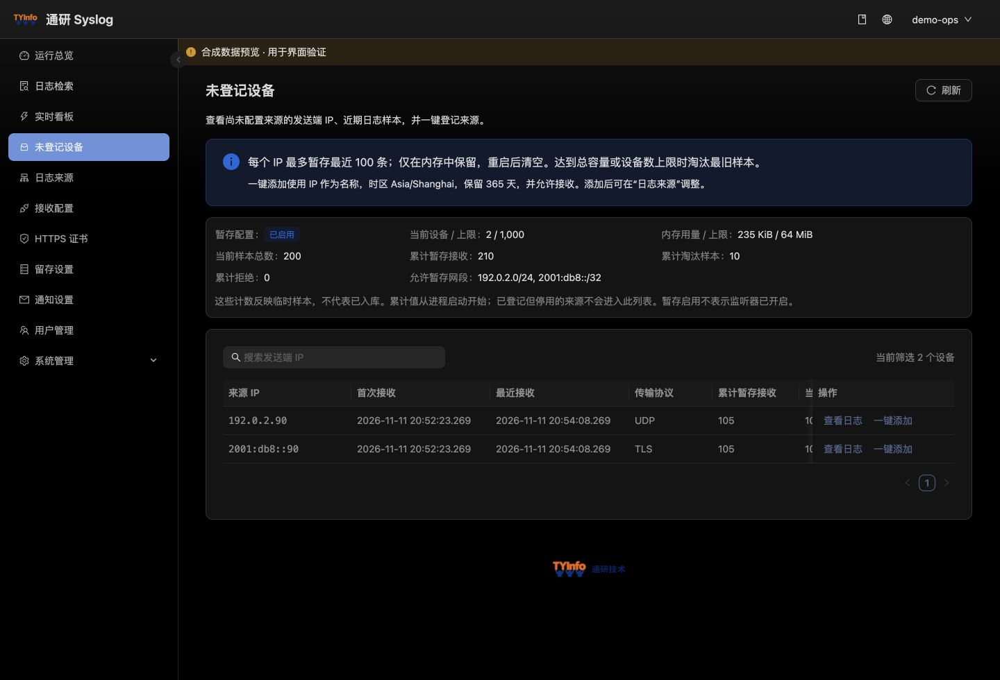
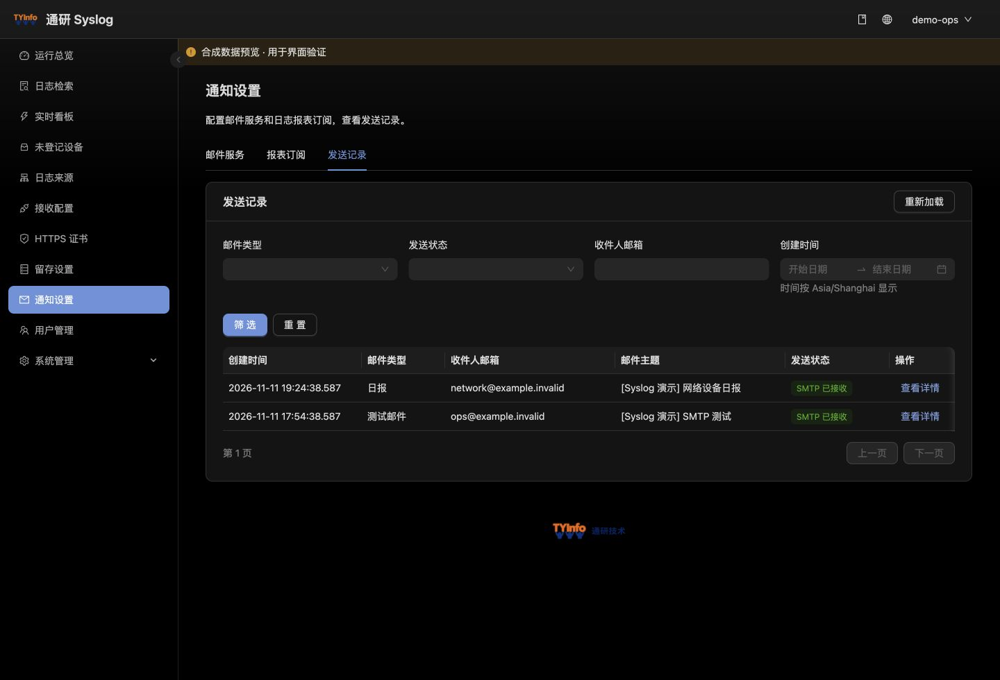
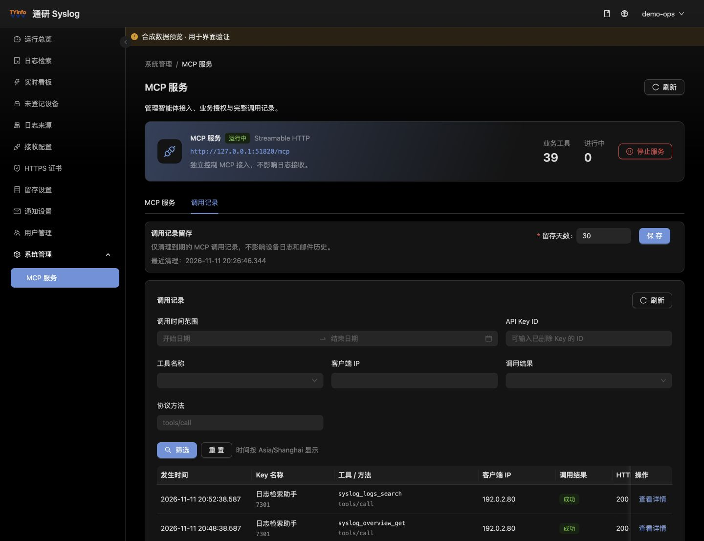

# 通研 Syslog

**简体中文**

**集中接收设备与应用日志，实时查看变化，按条件检索并追溯原始报文。**

通研 Syslog（Tongyan Syslog）适合运维和安全团队统一查看交换机、虚拟化主机、服务器及应用发送的 Syslog。设备发送报文后，系统按来源识别、解析并写入 ClickHouse；管理员可以在同一个 Web 管理台检查接收状态、排查写入积压、查找历史事件和查看原文。

**通研官网**：[www.tongyaninfo.com](https://www.tongyaninfo.com/)

**产品官网**：[syslog.tongyaninfo.com](https://syslog.tongyaninfo.com/)

[产品说明](docs/README.md) · [容器部署](deploy/docker/README.md) · [接口合同](docs/api/README.md) · [更新记录](CHANGELOG.md)

> 本项目为开源版本，源码以 [Apache License 2.0](LICENSE) 发布。示例部署地址与证书使用占位符，部署到自有环境时请替换为自己的域名与品牌。

当前源码版本为 [0.1.0](VERSION)，处于首批实现阶段，尚未封版。以下截图使用合成演示数据：账号、设备名称、日志及指标均为示例，设备地址采用文档保留网段。

## 主要功能

### 运行总览

查看累计接收、已写入和丢弃数量。速率图显示最近 60 秒的接收、写入和忽略速率，可切换到单个设备。结合待写入批次、本地暂存和日志库大小，判断问题出在接收还是写入。



### 实时看板

通过 SignalR 查看新日志，可按设备、时间、级别、主机、应用和关键词筛选，支持暂停、恢复和断线补取。每个已登记设备默认缓存最近 **5000 条**，全局默认预算 **512 MiB**，设置保存后立即生效。按规则忽略的日志标记为「已忽略 · 不入库」，仍可在缓存中查看原文；缓存随服务重启清空。



### 日志检索与原文

按接收时间、来源、严重级别、主机、应用和正文关键词查找已入库事件。查询结果按时间倒序翻页；详情并列显示解析字段与原始报文，支持文本和十六进制预览，便于复核解析结果。



<details>
<summary>查看日志详情与原始报文示例</summary>



</details>

### 设备接入与来源管理

在「接收配置」分别设置 UDP、TCP、TLS、RELP 的监听地址、端口和启用状态，并实时查看运行结果。对于许可网段内未登记的来源，可按 IP 查看最近最多 100 条样本，确认设备后直接登记。已登记来源可以独立设置时区、保留天数和忽略的严重级别，也可在确认后清空该设备的历史日志。



<details>
<summary>查看未登记设备与样本入口</summary>



</details>

### 日常管理与集成

| 功能 | 用法 |
| --- | --- |
| 留存设置 | 按来源设置新日志的保留天数，可选 1、2、3 年预设。已有日志的到期时间保持原值。 |
| 用户与 HTTPS 证书 | 管理管理员账号和会话；上传含私钥的 PFX/P12 后，新建管理 HTTPS 连接使用新证书。 |
| 邮件通知 | 配置 SMTP 并发送测试邮件，订阅按设备汇总的日报、周报或月报，查看发送记录。见[邮件通知与周期报表](docs/adr/ADR-0005-邮件通知与周期报表.md)。 |
| MCP 服务 | 默认停止。管理员可启用服务、创建按功能授权的只读或读写 API Key，并查询调用记录、配置审计留存。见 [MCP 服务说明](docs/spec/MCP服务需求与设计.md)。 |

<details>
<summary>查看邮件发送记录与 MCP 调用审计示例</summary>





</details>

## 本机体验

安装 Node.js 22 或更高版本，在项目根目录执行：

```sh
cd frontend
npm ci --ignore-scripts
npm run setup
preview_dir="$(mktemp -d)"
SYSLOG_BUILD_OUTPUT_PATH="$preview_dir/dist" npm run build
SYSLOG_PREVIEW_DIST="$preview_dir/dist" npm run preview:synthetic
```

打开 [本机合成预览](http://127.0.0.1:8019)，使用演示账号 `preview`、演示密码 `preview-only`。这个入口适合体验日志检索、原文详情、设备登记和留存设置。数据只保存在预览进程内存中；完整的 SignalR、持久化和设备接入验证请参阅[后端运行说明](docs/spec/首批后端运行与验证.md)。

## 部署与使用

仓库提供 [Dockerfile、Compose 和配置模板](deploy/docker/README.md)。管理台和管理 API 由同一个 ASP.NET Core 宿主通过 HTTPS 提供，ClickHouse 存放日志，SQLite 存放账号、来源、设置和审计。首次访问 ClickHouse 时，应用检查并创建缺失的日志库表；新 SQLite 控制库需要显式初始化，旧库按版本显式迁移。普通启动不会自动迁移 SQLite。

安装后，先初始化控制库并创建管理员，再登记日志来源、配置监听端口并让设备发送报文。到「运行总览」核对接收与写入状态，到「实时看板」看新日志，到「日志检索」确认历史事件和原文。各协议默认关闭，实际地址与端口以[接收配置](docs/spec/接收配置与RELP.md)为准。

当前单次历史检索最多 30 天，关键词按区分大小写的 ASCII 字母数字全词匹配。到期日志会从检索结果中隐藏，自动物理回收、中文全文检索、规则告警和日志回放仍待实现。截图用于说明操作，不能作为真实设备接入或性能验收依据。

## 开发与文档

| 入口 | 内容 |
| --- | --- |
| [后端](backend/README.md) · [前端](frontend/README.md) | .NET 10、React 19、Umi Max 与 Ant Design 6；构建、测试及预览命令 |
| [项目目录规划](docs/项目目录规划.md) · [开发约定](AGENTS.md) | 模块职责和开发边界 |
| [接口合同](docs/api/README.md) · [架构决策](docs/adr/README.md) | API、数据结构与架构约束 |
| [方案](docs/spec/README.md) · [版本与发布](docs/releases/README.md) | 功能规划、升级说明及验收边界 |
| [文档资源](docs/assets/README.md) | 截图索引与脱敏规则 |

## 许可证

本项目以 [Apache License 2.0](LICENSE) 发布，版权归通研信息（tongyaninfo）所有，详见 [NOTICE](NOTICE)。

管理台沿用 Ant Design Pro 模板的部分资产，遵循其 [MIT 许可](frontend/LICENSE)；第三方依赖分别适用各自的许可证，依赖清单与版本见 `frontend/package-lock.json` 与后端 `packages.lock.json`。

## 参与与反馈

- 贡献指南见 [CONTRIBUTING.md](CONTRIBUTING.md)。
- 安全问题请按 [SECURITY.md](SECURITY.md) 的流程私下报告，不要公开提交漏洞细节。
- 产品咨询与官网入口：[通研官网](https://www.tongyaninfo.com/) · [Syslog 产品官网](https://syslog.tongyaninfo.com/)。
