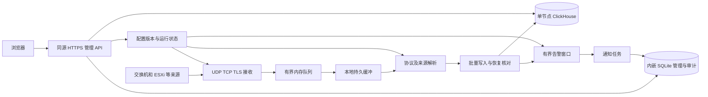

# 通研 Syslog 一期实施方案

编制：2026-11-09；状态更新：2026-11-10。单宿主与 ClickHouse 架构已接受，首批后端代码已建立；本文仍保留完整一期方案与候选验收目标，不能将计划全部视为已实现。真实交付范围见[首批存储实施合同](首批存储实施合同.md)，ClickHouse、真实端口、设备与性能尚未验收。依据：[产品规划](产品规划.md)、[功能需求清单](功能需求清单.md)、[架构决定](../adr/ADR-0001-轻量化长周期日志架构.md)。

面向约 1000 台交换机、ESXi 及其他日志源，支持用户在后台配置通常为 1～3 年的保留期。已采纳单机部署两个常驻服务：**.NET 应用与 ClickHouse**。SQLite 仅存管理数据，不承担多年日志全文检索。工程基线已按用户确认同步；普通启动不建库，真实 ClickHouse 初始化与具体环境操作仍需单独授权。

## 架构与组件



图中的接收、解析、写入、管理 API、告警和后台任务属于同一 .NET 宿主的独立模块；SQLite 不需要额外服务。前端构建文件由宿主提供。普通启动不自动建库、迁移、开防火墙或修改设备配置。

| 组件 | 建议职责 | 轻量约束 |
| --- | --- | --- |
| .NET 10 / ASP.NET Core | 接收、管理 API、任务调度、权限、告警、前端静态文件 | 一个宿主；接收、查询和后台任务分别限流限内存 |
| SQLite WAL | 账号、设备组、来源、规则版本、保留策略、任务状态、可靠审计 | 本机磁盘；短事务；管理变更与审计原子提交 |
| ClickHouse 单节点 | 原始字节、结构化事件、历史查询与聚合 | 非复制 MergeTree 系列候选；不需要 Keeper；批量入库 |
| 本地持久缓冲 | 数据库短时不可用与进程重启时恢复已持久报文 | 文件段、校验、检查点、容量上限；不作为长期归档 |
| React 19 / Umi Max / Ant Design Pro 6.0.3 | 查询与管理 UI | 沿用模板工具链，不新增独立前端运行服务 |

默认不引入 PostgreSQL、Kafka、RabbitMQ、Redis、Elasticsearch/OpenSearch、Kubernetes、对象存储或独立观测平台。未来只有在实测瓶颈或高可用需求出现时增加组件。

单宿主会共享故障域：应用崩溃时采集和管理同时中断。模块之间使用有界队列、独立并发预算和可取消任务降低相互影响，但无法做到进程级故障隔离。若查询或扩展解析持续影响接收，再启用独立接收宿主；该演进不等于本期已经具有高可用。

### 与现有仓库的兼容

早期的双宿主、全部 SQLite 与 Ingest 全库唯一写者草案已被 ADR-0001 替代。当前保留 Shared/Engine/Api/Ingest 职责分类，Ingest 已作为类库由 Api 宿主组合；独立接收宿主仍是后续演进方向。

管理服务独占 SQLite 管理写入，采集写入服务独占 ClickHouse 日志写入。HTTP Controller 只做参数、授权和调用；不把业务逻辑塞入 Controller，也不让采集工作器处理账号业务。无需为单机控制写入增加 IPC 命令总线。上述依赖与写入职责已落实到首批工程和开发约定；不由此推导真实数据库或性能已通过验证。

实体与 DTO 放 Models，接口放 Service，实现放 Service/impl，公共类型放 Common，配置放 Options，任务放 Workers，映射与迁移放 Data；规则与合成样本仍放根 rules 目录。引擎不依赖网络、数据库或 ASP.NET Core。

## 设备接入

### 协议与端口

| 入口 | 规划默认值 | 边界 |
| --- | --- | --- |
| UDP Syslog | UDP 514 | 一个数据报一条消息；可丢失、乱序和重复 |
| TCP Syslog | TCP 514 | 兼容常见部署；按监听器/来源显式选择帧模式 |
| 标准 Syslog TLS | TCP 6514 | 标准字节计数帧与证书校验 |
| ESXi TLS 兼容入口 | 可选 TCP 1514 | 按 ESXi 版本选择，不默认额外开放 |
| 管理入口 | HTTPS，端口待环境确认 | 内网/VPN/来源限制，与采集入口分开 |

标准 TLS 使用字节计数帧，TCP 兼容字节计数与分隔帧；TLS 加换行的厂商模式单独标注。字节长度不能按字符数计算。UDP 514、TLS 6514 及 TCP 历史用法依据 [RFC 5426](https://www.rfc-editor.org/rfc/rfc5426.html)、[RFC 5425](https://www.rfc-editor.org/rfc/rfc5425.html)、[RFC 6587](https://www.rfc-editor.org/rfc/rfc6587.html)；TLS 安全配置同时参考更新的 [RFC 9662](https://www.rfc-editor.org/rfc/rfc9662.html)。

所有监听地址和端口可配置。上线时逐项确认设备到接收器的路由、源接口、访问控制和证书；本系统不代替用户开放宿主端口。网络示例只使用 `syslog.example.com` 等占位地址。

### ESXi

接入向导读取用户登记的版本，并展示 `Syslog.global.logHost` 的目标格式，例如 `tcp://syslog.example.com:514` 或 `ssl://syslog.example.com:1514`。ESXi 的 `ssl://` 是配置名称，不意味着启用过时 SSL。远程保留期由本系统控制，本地轮转不控制远端留存。ESXi 远程转发也不等于 VM 内部日志采集。[Broadcom 配置说明](https://knowledge.broadcom.com/external/article/318939/configuring-syslog-on-esxi.html)

非标准端口的动态持久防火墙支持有 ESXi 7.0 U3q / 8.0 U2b 等版本条件，旧版本不能套用同一修改步骤。因此保留可选 1514 入口，不强制所有 ESXi 使用 6514。[Broadcom 自定义端口说明](https://knowledge.broadcom.com/external/article/384293)

证书链、SAN/主机名、有效期和设备时间都需要验证；其中服务端主机名由发送设备校验，平台提供证书与接入诊断，不将关闭检查作为默认修复。客户端证书认证按设备能力选择，不能要求所有交换机支持 mTLS。[Broadcom TLS 配置说明](https://knowledge.broadcom.com/external/article/324268)

发送端可能截断长消息；部分版本可通过 `Syslog.global.remoteHost.maxMsgLen` 调整非 UDP 上限。平台只能保存实际收到的字节，不能重建发送端已经丢失的内容。[Broadcom 长消息说明](https://knowledge.broadcom.com/external/article/345418/truncated-idps-logs-in-esxi.html)

### 交换机

按“品牌 + 型号 + 固件 + 协议 + 帧模式 + 来源接口 + 字段覆盖”维护兼容矩阵。Cisco、H3C、Huawei 等的发送级别、时间格式、来源接口和 TLS 能力存在差异，不生成一条通用配置命令。设备配置模板只在对应版本实测后标记通过。

例如 Cisco 设备正文可能带模块、级别和 mnemonic；H3C 信息中心可配置输出源及传输策略。通用接收不代表所有厂商字段都已准确识别。[Cisco Catalyst 9300 配置](https://www.cisco.com/c/en/us/td/docs/switches/lan/catalyst9300/software/release/17-15/configuration_guide/sys_mgmt/b_1715_sys_mgmt_9300_cg/configuring_system_message_logs.html)、[H3C 信息中心配置](https://www.h3c.com/cn/d_202610/2945297_30005_0.htm)

首次接入流程：登记来源 → 选择版本模板 → 配置目标 → 产生获准的合成标记 → 核对接收/解析/入库 → 检查原文/时间/级别 → 记录兼容结果。先选代表性的交换机与 ESXi 试点，再逐步接入 1000 台。

### 来源身份与缺报

分别记录资产 ID、连接来源 IP、报文 hostname 和可信中继标识；hostname、设备自报 IP 都是不可信输入。来源固定发送接口可减少资产漂移；NAT 或中继场景依赖显式映射。未登记来源只能在许可网段内进入有限配额的待确认区，不自动授予可信设备身份。

界面显示最后接收、最后成功入库和最近日志量。无新日志默认是“静默”，只有来源配置了预期周期，才按阈值判断“预期缺报”。Syslog 不替代 SNMP、ICMP、性能监控或 ESXi 管理 API。

## 接收与持久化边界

下面是初始压测参数候选，不是协议固定值或已验证生产参数。配置有系统总上限，不能因来源数量增加而产生无界缓冲。

| 项目 | 候选值 | 验证重点 |
| --- | --- | --- |
| 单报文接受上限 | UDP 16 KiB、TCP/TLS 64 KiB | 来源实际长度；UDP 分片风险；上限可按兼容策略调节 |
| 内存队列 | 5 万条或 128 MiB，先达到者生效 | 包括元数据与分配开销，不能只按条数预算 |
| TCP/TLS 连接预算 | 总计 2000 条，每源默认 4 条 | 1000 台长连接及重连余量；中继可单独提高配额 |
| 帧读取超时 | 不完整帧 30 秒 | 防止慢速填充；正常静默连接与半包超时分开 |
| 静默连接超时 | 初始 30 分钟，按设备行为调整 | 不把连接回收判断为设备离线，避免重连风暴 |
| 批量写入 | 1000～10000 条、8 MiB 或 1 秒边界触发 | 批次数、部件数量、延迟与内存的权衡 |
| 持久缓冲 | 按至少 30 分钟测得峰值预算，另设磁盘硬上限 | 容量不足必须显示可支撑分钟数，不宣称固定兜底时长 |
| 来源限速 | 根据采样配置 EPS 与字节率，允许短突发 | 不用统一过低值误杀正常 ESXi；单源不能占满总队列 |

UDP 超长报文默认拒绝并计数；若显式启用截断保存，必须标记实际保留长度和不完整状态。TCP/TLS 超长或非法帧按策略拒绝并关闭连接，不能无限等待读完。空报文、异常编码、过多结构字段都要有明确结果。

接收回调只做最小校验、来源识别、计数和入队。持久工作器写入带版本、长度、校验和的文件段，再交给纯解析器；文件段损坏隔离并报告，不能静默跳过。优先评估可维护的现成实现，不为轻量化自造分布式消息系统。

持久缓冲采用批量刷盘，候选最长未刷盘窗口为 1 秒，实际持久点由文件系统/设备同步结果确定。内存中或尚未刷盘的报文在崩溃、断电时仍可能丢失；持久缓冲与主库存于同一故障磁盘时也不能抵抗磁盘损坏。TCP 确认只表示传输层进展，Syslog 没有本系统入库的应用级确认。

队列或磁盘满时：UDP 丢弃新到报文并计数；TCP/TLS 先背压，在规定超时后断开并记录。禁止未经策略授权覆盖未处理持久段。监控同时观察应用丢弃、socket/内核丢包和网卡丢包；收不到的 UDP 无法仅靠平台计数精确还原。

## 解析与事件合同

基础协议解析覆盖 RFC 5424 与 RFC 3164，再按来源应用一个主正文解析器。PRI 得到 facility 和 severity；原始时间、结构化数据与正文均保留。旧式报文缺年份/时区时按来源策略推断并标记，而不把推断当原始证据。[RFC 5424](https://www.rfc-editor.org/rfc/rfc5424.html)、[RFC 3164](https://www.rfc-editor.org/rfc/rfc3164.html)

| 字段组 | 规划字段与意义 |
| --- | --- |
| 身份 | eventId、batchId、sourceId、listenerId、transport、peerIp、reportedHostname |
| 时间 | receivedAt、eventTime、originalTimestamp、timezoneUsed、timeConfidence、解析参考时间 |
| 协议 | facility、severity、appName、procId、msgId、structuredData |
| 业务 | vendor、product、component、eventCategory、interfaceName、userName、扩展字段 |
| 原始证据 | rawBytes、rawByteLength、rawHash、encoding、truncated、messagePreview |
| 解析 | parserId、parserVersion、parseStatus、failureCode、字段置信度、revision |
| 留存 | retentionPolicyId、policyVersion、expiresAt、入库/修订状态 |

字段是概念合同，不是已经授权创建的表结构。原始报文按传输解帧后的 Syslog 字节保存，帧模式另存；不声称保存了网络包全部字节。展示文本与原始字节分开，非法编码可以显示替换字符，但不能改写原始证据。

统一 `IIdService` 为事件和管理对象发号，建议评估应用内集中生成、持久节点标识和时钟回拨保护，避免新增远程发号服务依赖。具体实现仍须确认；各模块不得各自生成业务 ID。HTTP 中 long ID 使用十进制字符串。

时间存 UTC，接口带时区，界面默认 Asia/Shanghai 并可显式切换。无年份时间使用持久的 receivedAt 与来源时区推断邻近年份，跨年/歧义/超出合理范围分别标记；解析纯函数不可读取当前系统时间。默认检索按接收时间，可切换事件时间，并说明设备时钟异常可能影响结果。

内置解析优先支持真实首批交换机与 ESXi，其他来源采用通用正文。自定义解析器使用受限 JSON 定义、命名字段、正则超时、字段数量/长度限制；禁止代码、命令、SQL 和网络调用。解析失败保留原文、来源和原因，仍可查询。

## 存储与查询设计

### 选型取舍

| 方案 | 优点 | 本项目判断 |
| --- | --- | --- |
| SQLite 保存全部日志 | 零独立数据库服务 | 多年海量日志的分片、全文检索与并发维护成本高，不作为主推荐 |
| PostgreSQL 保存全部日志 | 事务与管理数据方便 | 可作为实测低量时的备选，但长周期日志聚合与存储体量需额外评估 |
| ClickHouse 日志 + SQLite 管理 | 两个常驻服务，压缩列式存储、时间聚合、管理事务分离 | 已采纳架构；首批代码已有，批量写入、恢复、搜索与保留仍须真库验证 |
| Elasticsearch/OpenSearch 等完整搜索体系 | 搜索能力丰富 | 当前轻量目标下不作为默认依赖 |
| 压缩文件加自建索引 | 常驻服务少 | 会自担索引、并发检索、恢复与回放复杂度，不作为一期捷径 |

ClickHouse 的排序键、常用字段列化、压缩编码和索引都影响查询与空间；不为每个扩展字段建索引，也不直接照搬通用日志表。原始字节与规范化检索正文共同保存，前者用于证据，后者用于文本查询；这部分有意冗余纳入容量系数，不再额外永久复制整份 JSON 包。首批使用原生 HTTP 客户端、最低目标版本 26.8 与显式初始化 SQL；SQL 尚未真库执行，schema 与索引效果须经基准测试验证。[ClickHouse 日志 schema 指南](https://clickhouse.com/docs/guides/use-cases/observability/build-your-own/schema-design)

### 数据布局

首批日志表按接收时间的月粒度分区，排序键为 (received_at, event_id, source_id)，前两列与列表排序一致；不按 1000 台设备各建表或各建分区。须同时实测“指定设备时间段”和“全设备某时间段”查询，排序收益尚未验证；只在收益明确时增加投影或跳数索引。

基于接收时间分区能避免错误设备时间造成错误落盘与提前到期。事件时间查询不能仅依事件日期裁剪接收分区；应利用可靠时间范围元数据或扩大扫描范围。严重级别、来源、应用、常查接口字段显式列化；少量扩展字段受大小和基数限制。

告警实例、审计和任务都有独立保留策略。SQLite 不存每条日志对应的收发审计或全量运行指标；持久通知队列按规则冷却合并、限制积压，防止控制库被事件洪峰撑满。

### 重试与回放

持久段保存稳定 eventId、batchId、分块方式、内容摘要和解析版本。写入超时表示“提交结果不确定”，不能换 ID 重试。确认入库后持久记录检查点，才按已批准的缓冲清理策略回收对应段。

单节点 MergeTree 的插入去重依赖版本和有限去重窗口，实施时须显式验证，不能假定默认生效。窗口内保持 token 和批次稳定；跨窗口或长期恢复的未知批次先暂停该批次重试，核对 batchId、事件集合与数量，待原请求确认结束后再补缺；核对期间相关统计标记不完整。跨本地缓冲、SQLite 和 ClickHouse 不存在统一事务。[ClickHouse 插入重试说明](https://clickhouse.com/docs/concepts/features/operations/insert/deduplicating-inserts-on-retries)

不依赖 `ReplacingMergeTree` 后台合并来保证实时计数唯一。若采用版本表，查询合同必须使用受范围限制的逻辑去重/最新版本选择，不能把多年全库 `FINAL` 扫描当默认方案。[ClickHouse ReplacingMergeTree](https://clickhouse.com/docs/reference/engines/table-engines/mergetree-family/replacingmergetree)

回放有两种模式：使用旧解析器复现；选择新版本修复。两者沿用原 eventId、原 receivedAt 及原事件已应用的保留策略/到期时间，不能因回放延长留存；结果以 eventId 与解析版本标识，重复任务幂等。回放不增加接收统计，不默认发送历史告警。修复结果采用追加修订并受控切换当前视图，原文不变；统计重建和修订进度须可见。这是开发验收重点，若无法在目标规模满足成本，须在 M0 调整实现再进入开发。

### 查询体验与资源限制

默认最近 15 分钟。接收时间、设备组、设备、IP、MAC、接口名及可提取的事件码优先走结构化过滤。30 天内跨设备的普通关键词查询是前台功能，首批方案为对规范化正文建 ClickHouse `text` 倒排索引，使用与索引分词一致的词匹配，按时间返回首屏。列表只取展示字段，完整原文按需读取，精确总数和大范围统计单独执行。以持续写入时的索引空间、资源占用和可见延迟作为选型依据。[ClickHouse 文本索引](https://clickhouse.com/docs/reference/engines/table-engines/mergetree-family/textindexes)

检索正文按已确认来源编码规范化为 UTF-8，并保留编码与转换状态；无法判定或解码失败的报文仍可查元数据与原始字节，明确标记文本检索受限。词匹配、短语和任意子串分别定义语义。首批仅接受区分大小写的 ASCII 全词 AND，中文、非 ASCII 混合及纯符号明确返回 unsupported_search_token。中文短词和常用子串需在后续按代表性样本验证分词及 n-gram 候选，子串仍需核验实际匹配。前台只开放满足扫描预算的组合，超出范围时提示缩小时间或限定设备。复杂正则仅可在受限结果集执行。[ClickHouse 文本索引查询规则](https://clickhouse.com/docs/reference/engines/table-engines/mergetree-family/textindexes)

业务日志采用稳定排序 `(receivedAt, eventId)` 与不透明游标，携带过滤条件摘要和查询锚点，不能越权复用。这是稳定翻页，不是跨请求数据库快照：迟到提交可能落在已翻过区间，回放修订也可能改变匹配结果，界面提示刷新获取变化。页大小默认 100、上限 500；不为首屏强制执行全库精确 COUNT。需要一致结果的导出任务固定已确认连续提交水位和解析修订水位；仅以 receivedAt 截止不足以冻结结果。任何查询的到期过滤和权限撤销始终优先。小型管理列表仍用 page/pageSize/total。首批日志游标合同已落地；导出及其一致水位仍未实现。

候选限制：前台查询 4 个并发、历史扫描 1 个并发、每用户 1 个导出。为前台请求设置执行时间（初值 10 秒）、读取量和内存预算，达到上限时取消并明确提示，避免未命中索引时扫描整个时间窗口。预算超限不能当作零结果，也不自动转后台。用户可另行发起受控历史任务或导出，查看进度及取消。30 天普通关键词查询只有通过同步首屏验收才算达标。

日志详情显示最多 8 KiB 文本预览，明确截断；完整原始字节的受控下载不经过 HTML 渲染。导出采用任务、权限复核、行数/字节双上限、限期下载和 CSV 公式转义，不把日志或凭据放在 URL、localStorage 或公开下载链接。

## 自定义保留与容量治理

### 后台策略

后台提供全局策略、设备组覆盖及少量设备例外，按“设备 → 组 → 全局”计算最终策略。预设 365/730/1095 天并明确显示天数，标注约 1/2/3 年；自定义为正整数天，不把“3 年”含糊当精确日历年。永久保留默认关闭，超大保留值需显示容量影响。

默认保留原文和结构化详情相同期限。热数据期限与最终保留期独立：例如最近 30 天放 SSD，历史放较低成本本地卷，仍从同一页面在线查询。SSD/HDD 分层是可选优化，首版单卷也可运行；离线压缩归档/对象存储回读属于 P2，不默认为用户开启。

### 政策变化与删除

每次修改保留策略必须显式选择“仅新接收数据”或“新数据与已有数据”，并显示继承影响。策略版本与 expiresAt 写入事件；正常接收只读取已应用的配置版本。用户调整的是策略数据，不是开放任意 DDL 权限。

为让历史延长与清理互斥，首版建议由应用持久任务统一调度删除，不启用 ClickHouse 独立自动删除 TTL。每个范围先登记清理计划与策略版本，执行前重新校验；历史变更先持久冻结该范围的新清理任务，确认已发往数据库的删除已终结，再重新预览仍存在的数据。不能撤回或尚未查明的删除不报告为已暂停。应用重启先恢复并核对任务状态，再开放清理调度；ClickHouse 重启也不会自行按旧删除 TTL 清理。

历史变更按任务处理：预览范围和容量 → 权限与明确确认 → SQLite 保存计划及审计 → 建立上述清理屏障 → 分区批次重算到期数据 → 应用并核验 → 恢复清理 → 记录结果。整分区全部到期时优先回收分区，其余使用受控批次清理；混合保留策略与原文/修订的同步删除须压测，不能为每设备建立大量分区。大范围重算会产生 I/O，必须限速并允许维护窗口；不承诺修改后立即释放空间。未来采用自动删除 TTL 前，必须另行证明策略变更屏障覆盖在途合并和数据库重启。当前不执行任何 DDL 或删除。

缩短保留可能不可恢复，必须告知预计最早保留时间、涉及来源、条数/字节估算和备份状态。延长只能作用仍存在的数据；已过期隐藏但尚未物理删除的数据是否重新可见必须单独确认并审计，不能通过简单改天数绕过删除意图。

API 按每条事件已应用的 policyVersion/expiresAt 和已确认的历史策略覆盖状态过滤到期数据，不能将最新全局天数直接套用到全部旧数据，否则会违背“仅新数据”。存储页分别显示到期不可查、待物理清理、清理完成及失败；物理空间释放由任务完成后核验。ClickHouse 的 TTL 本身是后台机制，不提供到点立即物理删除保证，可用于未来经验证的清理或可选冷热移动，不能把其调度间隔当删除 SLA。[ClickHouse TTL](https://clickhouse.com/docs/concepts/features/operations/delete/ttl)

自动清理仅在用户启用并确认具体范围的保留策略后执行，这是产品内的持续授权；变更策略或手动提前删除需要再次确认。清理审计以策略版本、批次和分区为单位，记录范围、预估/实际结果和恢复状态，不为每条到期日志产生一条控制库审计。

手动删除、备份到期和持久缓冲回收分别有策略，不能用“删除在线数据”推导备份也已清除。副本/备份上的删除传播及保留冲突须列出，操作系统删文件也不等于介质不可恢复擦除。

### 磁盘阈值

候选阈值：使用率 70% 预警并预测剩余天数；85% 限制大导出、回放和历史扫描；95% 进入紧急状态并按协议背压/丢弃。预留控制库、审计与恢复所需空间，阈值按真实文件系统调整。

容量不足不能自动删除未到期日志或修改保留设置。界面明确展示“按当前平均速率预计还能保留多少天”和“达到当前策略需要多少空间”，由用户选择扩容、调整来源级别、缩短保留或启用归档。

## 容量模型与资源预算

设备数量仅用于资产与连接预算；存储以全年平均 EPS 计算，接收与缓冲以峰值和持续时长计算。

```text
events = averageEPS * 86400 * retentionDays
rawBytes = events * averageMessageBytes
storedBytes = rawBytes * effectiveStorageFactor
usableDataVolumeBytes = storedBytes / (1 - freeSpaceRatio)
spoolBytes = peakEPS * peakDurationSeconds * persistedEnvelopeBytes
```

下表假设每条原文 1 KiB、每年 365 天、压缩后的原文/结构字段/必要索引合计为原文 **0.4 倍**、预留 30% 空闲；TB 是十进制 10^12 字节。这些不是实测压缩率，不含备份、缓冲、系统盘、临时导出与 RAID 冗余。

| 总平均 EPS | 每台平均条/秒 | 每年日志条数 | 1 年在线数据 TB | 3 年在线数据 TB | 1 年可用数据卷 TB | 3 年可用数据卷 TB |
| ---: | ---: | ---: | ---: | ---: | ---: | ---: |
| 100 | 0.1 | 31.54 亿 | 1.29 | 3.88 | 1.85 | 5.54 |
| 1000 | 1 | 315.36 亿 | 12.92 | 38.75 | 18.45 | 55.36 |
| 5000 | 5 | 1576.80 亿 | 64.59 | 193.76 | 92.27 | 276.80 |
| 10000 | 10 | 3153.60 亿 | 129.17 | 387.51 | 184.53 | 553.59 |

总系数为 0.2 时容量减半，0.8 时翻倍，真实情况也可能超出区间；平均报文增至 2 KiB 也翻倍。计算需使用 7 天以上代表性数据，包含业务高峰、故障洪峰和必要的维护期，不能只测平静的一小时。

若选择 30 分钟峰值缓冲，例如峰值 5000 EPS、每条持久信封 1.25 KiB，则原始缓冲约 11.52 GB，另计段管理与空闲；这不是 30 分钟数据库备份。备份独立测算：完整副本至少再需要实际数据体量，保留多个恢复点的开销依增量和去重能力实测。

| 场景 | 初始压测硬件候选 | 用途与限制 |
| --- | --- | --- |
| 代表性试点 | 4 vCPU / 16 GiB RAM / SSD 测试卷 | 检验低平均量与受限查询，不能宣称支持三年完整容量 |
| 初始生产候选 | 8 vCPU / 32 GiB RAM / SSD 热卷 + 按模型配置数据卷 | 作为 100～1000 EPS 的压测起点，是否合格以结果决定 |
| 持续 5000～10000 EPS 且多年在线 | 单独做 16 核以上/64 GiB 以上及存储 I/O 评估 | 可能需要数百 TB；超出低资源单机定位，重新评审预算与范围 |

32 GiB 候选可先给 ClickHouse 16～20 GiB、应用 2～4 GiB，其余留给系统与文件缓存；查询单任务再设上限。内存设置是压测起点，不是吞吐保证。ClickHouse 资源需求取决于并发、吞吐、数据量和保留期，冷热磁盘能降低费用但会改变历史查询延迟。[ClickHouse 硬件指南](https://clickhouse.com/docs/guides/oss/best-practices/sizing-and-hardware-recommendations)

轻量方案不等于 2 核 4 GiB 能满足 1000 台多年任意检索，也不意味着 55 TB 原始硬盘就能提供 55 TB 可用数据卷。采购需扣除 RAID/文件系统、故障冗余与备份，并以目标硬件实测确定。

## 告警与统计

一期告警包括关键字/级别、计数频率和有界关联窗口。候选模板：同设备同接口 5 分钟内多次 link 变化；同来源 5 分钟多次认证失败；ESXi 特定存储错误在窗口内达到阈值。模板只在字段适配并验证后启用，不默认给所有设备套同一阈值。

规则包括过滤条件、分组键、阈值、统计窗口、冷却、静默和通知渠道；窗口状态按来源/规则限制数量，恶意高基数字段不能无限扩张内存。默认按 receivedAt 评估实时告警，事件时间分析单独说明迟到语义。解析失败可触发接入质量告警，不能无条件当业务攻击。

已确认唯一的事件才推进正常告警计数；自动重试未确认的写入时显示对应积压。告警消费水位独立于缓冲回收水位持久化，入库后崩溃可以从已确认事件继续消费；窗口状态、命中身份、消费进度与通知任务协调提交或重建，避免仅释放缓冲就漏报。清理不得越过尚未消费的告警水位而不报告异常；若达到保留/容量边界必须显示无法完成的范围，不无限保留。告警实例和通知任务持久化，重启恢复冷却和进度，Webhook 有通知 ID、超时、有限重试和最终失败状态。对端未实现幂等时可能重复收到，应在通知合同说明。

通知正文默认发送摘要与受权限保护的日志链接，不包含完整敏感原文。URL 受配置白名单约束，限制重定向与目标网段，防止日志字段构造外部请求。外部 IP 归属查询在持久化后异步执行，有缓存、超时、并发限制和关闭开关，不影响接收与基础检索。

## 权限与可靠审计

API 层强制设备组范围，详情、查询、聚合、上下文、导出和后台任务都要执行同样校验。原文访问与导出单独授权。会话使用安全 Cookie，防 CSRF、会话固定与开放重定向；禁用用户或调整权限使旧会话及时失效。

管理对象变更和操作审计在 SQLite 同一事务提交。监听器启动、规则加载、导出、删除等外部效果通过持久任务执行：先记录计划与授权，再执行并记录结果，区分已保存/待应用/已应用/失败。若审计不可写，不报告操作成功；无法原子完成的外部效果要保留待核对状态。

原始日志本身可能含秘密，显示脱敏不等于原文已脱敏。采集范围、原文权限、存储介质加密与备份访问控制由部署策略明确。密码、证书和 Webhook 秘钥使用受控配置或私有机制，公开配置只留占位符。

SQLite WAL 适用于同机受控并发，仍需短事务与检查点治理，活动数据库不放共享网络文件系统；管理审计不应与巨量日志共库。备份使用一致性备份机制，不能直接复制正在写入的主文件当完整备份。[SQLite WAL](https://www.sqlite.org/wal.html)、[SQLite Backup API](https://www.sqlite.org/backup.html)

## API 与任务合同

接口前缀沿用 `/api/admin/v1`，业务响应为 `ApiResult<T>`：success/code/message/data，保留真实 HTTP 状态码。首批已有 session、sources、logs、system 分组，实际路由以[API 合同](../api/README.md)为准。listeners、queries、parsers、replays、alerts、retention-policies、storage、exports、backups、users、audit、tasks 的独立管理路由仍是后续规划。

检索使用 POST 传过滤条件，避免将敏感日志查询写入 URL；服务端参数化并白名单限制字段/排序。任务受理返回 202 与 taskId，表示已可靠受理，不表示完成；终态包括 succeeded、failed、cancelled、partial 和需要人工核对的状态。版本冲突 409、查询限额 429、系统或可靠审计不可用 503。

完整规划中，管理列表使用有上限的分页，大日志列表使用游标；查询锚点和 count 状态按实际能力定义，不虚构精确总数。首批日志列表已有 items、nextCursor、hasMore，未实现 queryAnchor、准确计数或独立原始字节下载；当前字段以[API 合同](../api/README.md)为准。原文预览与原始字节下载的权限仍需分别校验，不能通过替代路由绕过授权。

## 部署与运维

优先 Linux 单机，systemd 服务或双服务 Compose 二选一；不同时维护多套未经验证的部署形态。主机地址、访问方式与端口继续保留占位符，具体交付资源尚未确定。

SQLite、持久缓冲、ClickHouse 数据和备份目录分别配置。ClickHouse 管理端口只允许应用/运维受控访问，不对设备开放；设备只访问批准的 Syslog 端口。容器端口映射可能改变来源 IP，须按目标网络验证。低端口使用明确授权的最小能力或端口映射，不以 root 运行整个应用来省事。

如为排查 ESXi 主机故障，日志服务不应只部署在被排查的同一台 ESXi 上；否则主机故障时采集也停止。选独立主机或不同故障域，并保留设备本地日志。

上线前显式初始化存储，升级先停写、备份、运行已批准迁移、验证再恢复接收。单节点维护会产生采集窗口，设备能否缓冲/重发必须实测。回滚应用版本不自动回滚不兼容数据库结构，应验证从备份恢复的路径。

备份策略建议控制数据每日及重大变更前备份，日志按数据价值与预算设周期，备份放不同故障域并做抽样恢复。初始恢复目标候选：控制配置 RPO 24 小时、重大变更另行备份；服务 RTO 4 小时需演练确认。多年日志的全量恢复时间单独按 TB 与实际吞吐计算，不能承诺也在 4 小时内恢复。例如仅复制 40 TB，以持续 200 MB/s 计算约 55.6 小时，尚不含校验与重建。

平台暴露接收报文/字节、解析状态、持久队列、入库延迟/失败/最后成功、丢弃、连接、CPU/内存/磁盘、查询时延、到期清理积压、备份和通知结果。可输出标准指标接口，但不要求额外安装 Prometheus/Grafana 才能使用后台。

## 测试与验收

所有目标均需在批准硬件与隔离环境完成。先测 100、1000 EPS，再测 5000、10000 EPS 阶梯和短突发；高档位是测量场景，不作为当前已支持性能。容量/查询用代表性长度、重复率、字段基数、来源分布，不能用单条高度重复日志推断压缩收益。

| 验收项 | 目标与测量方式 |
| --- | --- |
| 设备与连接 | 1000 合成来源、2000 连接预算、重连风暴、每源限速与全局上限 |
| 持续摄入 | 合格档位至少 24 小时并发查询测试，记录发送/接收/刷盘/解析/提交/丢弃差异 |
| 近期可见延迟 | 正常负载下已接收日志入库可查 P95 ≤ 5 秒候选目标；积压场景另报 |
| 近期查询 | 指定设备/组 + 最近 24 小时，首屏 P95 ≤ 2 秒候选目标，统计和总数另计 |
| 30 天在线查询 | 以 1000 EPS、约 25.92 亿条的代表性 30 天数据为目标，持续写入且最多 4 个前台查询并发。对权限范围内跨设备的普通关键词（无命中、稀有词、常用高频词）和结构化筛选分别测首屏 100 条，P95 ≤ 5 秒为候选目标。分别报告冷、热缓存结果，超时、降级和后台执行计为未达标 |
| 年级历史 | 1/3 年代表性完整数据规模验证分区裁剪、扫描字节、时延和并发；不承诺统一秒级 |
| 传输边界 | 半包/粘包/中文长度、长消息、连接闲置、TLS 信任失败、非法帧和断连恢复 |
| 解析 | RFC 字段、时间推断、非法字节、自定义规则资源上限、原文逐字节比对 |
| 恢复 | 入库响应丢失、去重窗口外重试、缓冲损坏、应用重启、磁盘满及受控断电 |
| 幂等 | 稳定事件/批次、版本回放、统计不重计、告警不重发、未知提交可核对 |
| 留存 | 新旧策略范围、延长/缩短、到期过滤、异步物理删除、重启恢复和备份边界 |
| 安全 | 设备组越权、CSRF、会话失效、XSS/CSV 注入、SSRF、审计失效、秘密不泄露 |
| UI | 1440×900 与 1920×1080 主视口，空态、错误态、长原文、取消任务和权限变化 |
| 交付 | 备份恢复演练、容量报告、版本清单、部署/回滚说明与实测兼容矩阵 |

若不能构造与实际多年规模相符的数据，只能验收功能边界及已测试规模，报告中明确历史性能未验收，不能用空库测试推导三年性能。最终合格吞吐取决于设备采样和硬件，作为版本能力档位记录。

30 天查询验收须检查索引执行计划，记录查询延迟、逻辑读取行数及字节数、物理磁盘读取和峰值内存，并同时记录入库积压、索引增量空间。查询日志的逻辑读取量与磁盘读量分别统计。合格标准须在选定单节点硬件上实测，未通过时调整索引或资源预算，再评审交付范围。[ClickHouse EXPLAIN](https://clickhouse.com/docs/reference/statements/explain)、[查询日志](https://clickhouse.com/docs/reference/system-tables/query_log)

## 风险与实施门槛

| 风险 | 影响 | 处理 |
| --- | --- | --- |
| 未知 EPS 与长度 | 磁盘、CPU 或网络低估 | M0 先采样，按平均/峰值分别预算 |
| 多年任意文本查询 | 大量扫描，干扰摄入 | 限范围、限并发、字段化、后台历史任务 |
| 单宿主/单节点故障 | 管理与采集可能同时中断 | 持久缓冲、独立备份、设备本地日志；高可用另评审 |
| 厂商协议差异 | 收到但解析错误或截断 | 版本矩阵、原文证据和兼容测试 |
| 自定义保留影响历史 | I/O 冲击或错误删除 | 范围预览、审批、分批任务、删除与延长竞态测试 |
| 双存储与重放幂等 | 不存在跨库事务，可能重复/遗漏 | 稳定身份、自动重试与去重窗口、注入失败测试、不得声称绝不丢失 |
| 轻量目标与数百 TB 冲突 | 小型主机无法同时满足长期与快查 | 缩小无价值来源、评估冷热盘或归档，用户决定取舍 |

M0 必须完成四项后才进入完整实现：确认架构 ADR 与 ID 方案；取得代表性设备/流量数据；在获准环境验证批量入库、查询、恢复去重及历史保留变更；确认服务器容量与验收档位。排期见[产品规划](产品规划.md)。
